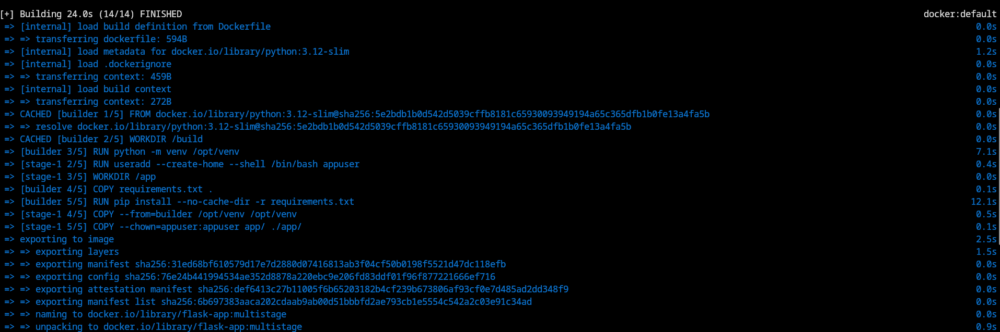
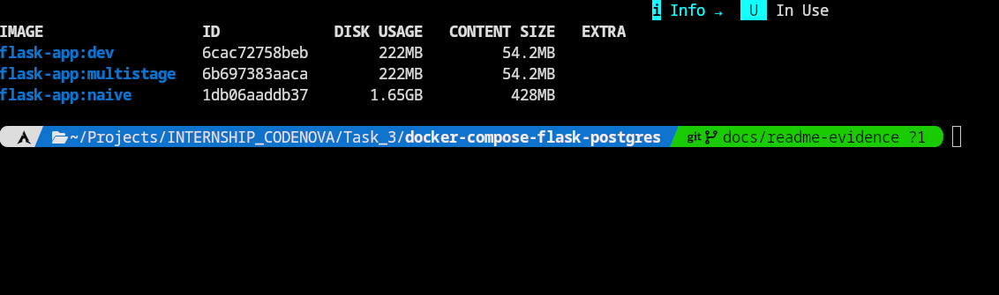
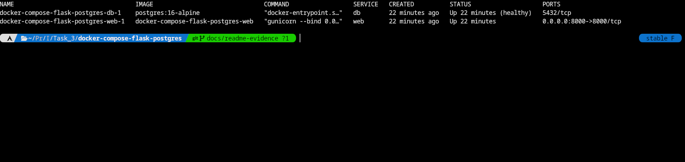
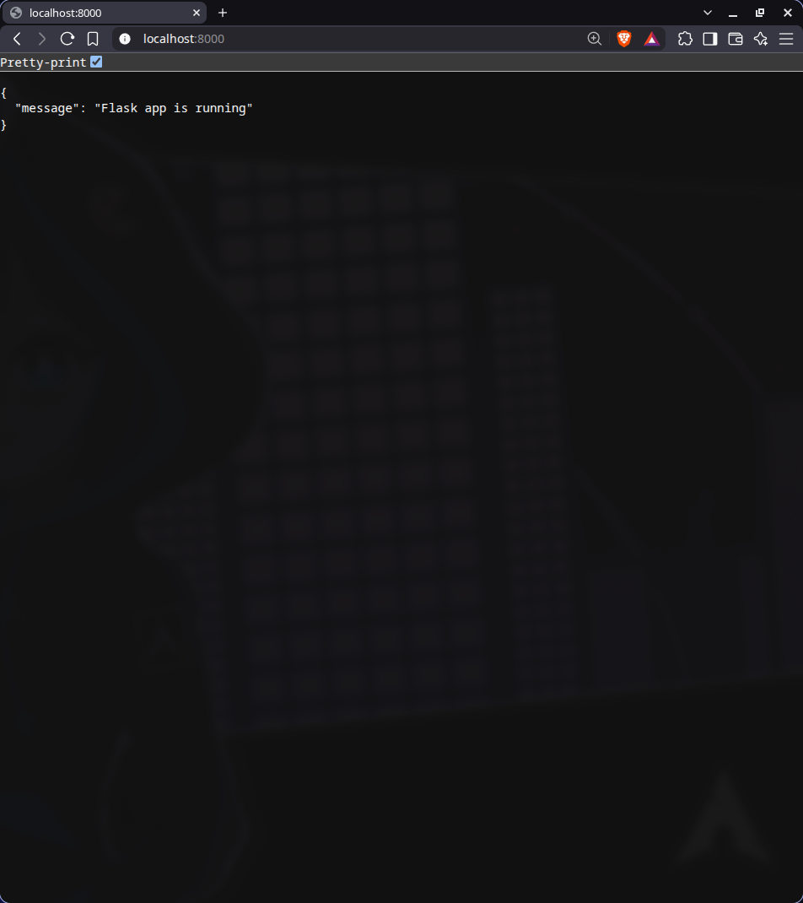
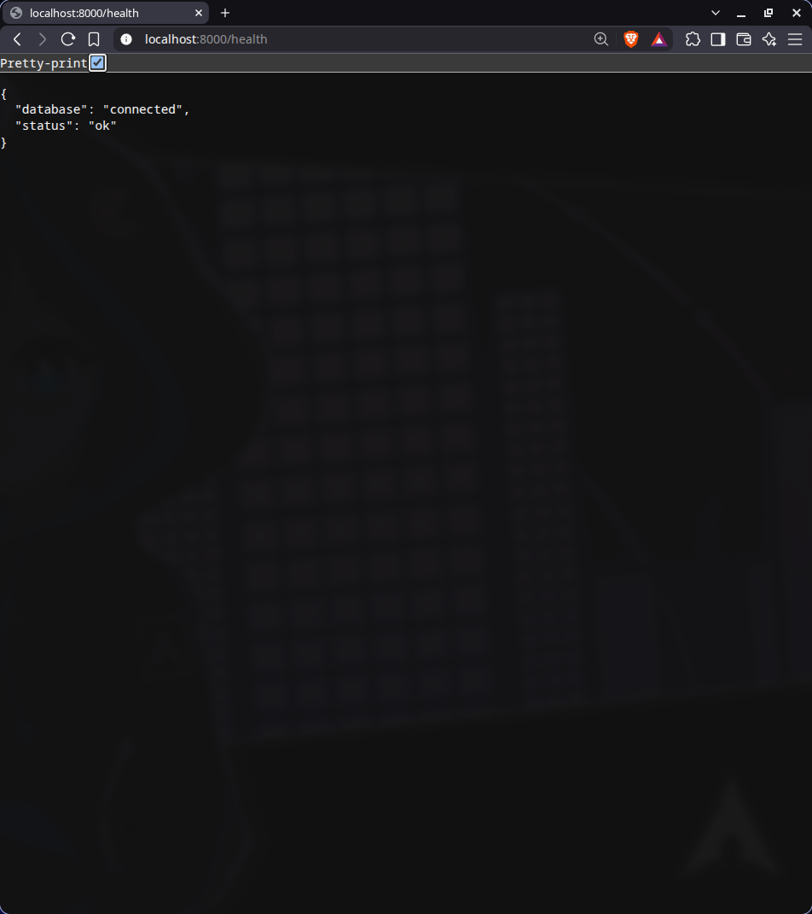
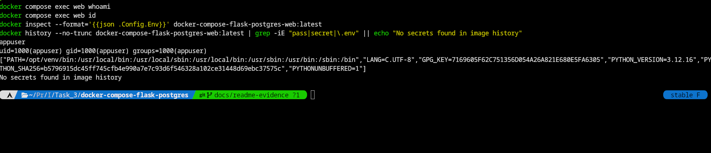
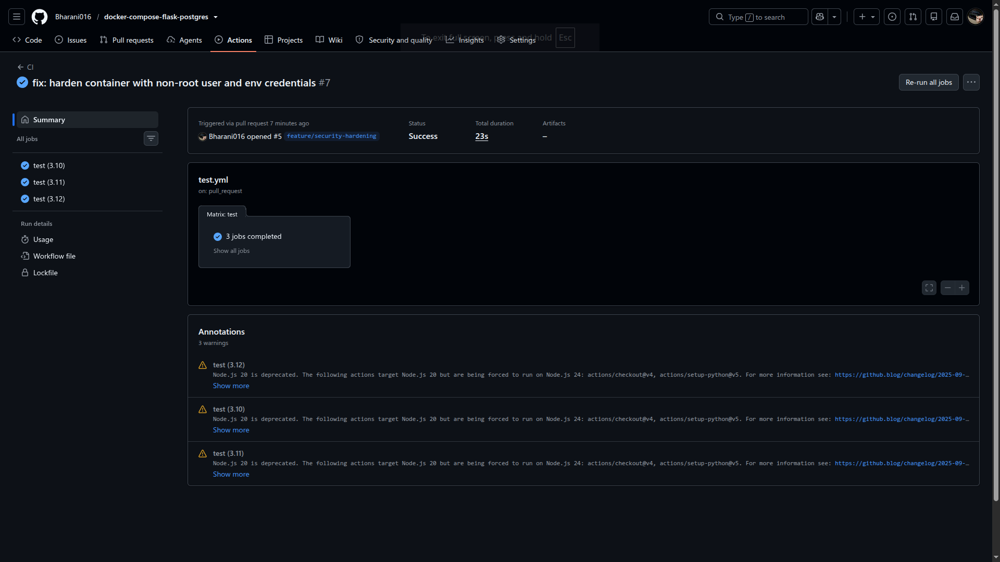

# Docker Compose Flask + PostgreSQL


A containerized Python Flask web application backed by PostgreSQL using Docker Compose. The project demonstrates multi-stage Docker builds, least-privilege container hardening, service healthchecks, and automated multi-version CI with GitHub Actions.

---

## Features

- Multi-stage Docker build (`python:3.12-slim`) for a lean production image
- Docker Compose orchestration with service healthchecks and persistent storage
- PostgreSQL 16 (`postgres:16-alpine`) isolated on an internal Compose network
- Gunicorn production WSGI server
- Non-root container execution (`appuser`, `uid=1000`)
- Database-backed `/health` readiness endpoint
- Automated GitHub Actions CI pipeline (Python 3.10, 3.11, 3.12)
- Conventional Commits workflow with branch protection on `main`

---

## Project Structure

```text
.
├── .github/
│   └── workflows/
│       └── test.yml             # Multi-version CI pipeline
├── app/
│   ├── __init__.py
│   └── app.py                   # Flask app (/ and /health routes)
├── tests/
│   ├── __init__.py
│   └── test_app.py              # Mocked pytest unit tests
├── assets/
│   ├── 01-build-nocache.png     # Clean multi-stage build output
│   ├── 02-image-size.png        # Naive vs. multi-stage image size comparison
│   ├── 03-compose-ps.png        # Running Compose services
│   ├── 04-browser-home.png      # Browser check on /
│   ├── 05-browser-health.png    # Browser check on /health
│   ├── 06-security-proof.png    # Non-root user & secret-free image proof
│   └── passing-run.png          # GitHub Actions CI matrix run
├── Dockerfile                   # Multi-stage build with non-root user
├── docker-compose.yml           # Orchestrates web, db, network, and volume
├── .dockerignore                # Excludes .git, .venv, .env, tests, and cache
├── .flake8                      # Linter configuration matching black
├── requirements.txt             # Production dependencies
├── requirements-dev.txt         # Development & test dependencies
├── .env.example                 # Template for required environment variables
├── LICENSE
└── README.md
```

---

## Build and Run (Docker Compose)

1. Clone the repository and create your local environment file:

```bash
git clone [https://github.com/Bharani016/docker-compose-flask-postgres.git](https://github.com/Bharani016/docker-compose-flask-postgres.git)
cd docker-compose-flask-postgres
cp .env.example .env
```

2. Build and start the stack:

```bash
docker compose up --build -d
```

3. Verify both containers are healthy and running:

```bash
docker compose ps
```

4. Test the endpoints:

```bash
curl -i http://localhost:8000/
curl -i http://localhost:8000/health
```

| Endpoint | Method | Expected Status | Expected Response |
|----------|--------|-----------------|-------------------|
| `/` | `GET` | `200 OK` | `{"message": "Flask app is running"}` |
| `/health` | `GET` | `200 OK` | `{"database": "connected", "status": "ok"}` |

5. Stop the stack:

```bash
docker compose down        # Stop containers (preserves pgdata volume)
docker compose down -v     # Stop containers and delete pgdata volume
```

---

## Architecture & Compose Stack

| Component | Type | Role |
|-----------|------|------|
| `web` | Service | Flask app served via Gunicorn on port `8000` (`appuser`) |
| `db` | Service | `postgres:16-alpine` on internal port `5432` with `pg_isready` healthcheck |
| `pgdata` | Named Volume | Persists PostgreSQL data across container restarts |
| `default` | Bridge Network | Private network allowing `web` to reach `db:5432` without exposing Postgres to the host |

`web` uses `depends_on: condition: service_healthy` so it waits until PostgreSQL is ready before accepting requests.

---

## Image Optimization

The `Dockerfile` uses a two-stage build on `python:3.12-slim`:

- **Builder stage:** Creates an isolated virtual environment at `/opt/venv` and installs runtime dependencies from `requirements.txt` with `--no-cache-dir`.
- **Final stage:** Copies only `/opt/venv` and `app/` into a clean slim image, leaving behind build caches and development tools.

| Build Strategy | Base Image | Disk Usage | Content Size | Size Reduction |
|----------------|------------|------------|--------------|----------------|
| Naive single-stage (`flask-app:naive`) | `python:3.12` | 1.65 GB | 428 MB | — |
| Multi-stage (`flask-app:multistage`) | `python:3.12-slim` | **222 MB** | **54.2 MB** | **~86.5% smaller** |

---

## Security Hardening

- **Non-root execution:** Creates `appuser` (`uid=1000`) and runs the container via `USER appuser` with `--chown=appuser:appuser`.
- **Externalized credentials:** Database credentials are loaded at runtime from a gitignored `.env` file; only `.env.example` with placeholders is committed.
- **Zero secrets in image layers:** Verified via `docker inspect` and `docker history --no-trunc`.
- **Network isolation:** PostgreSQL port `5432` is never published to the host machine.
- **Build context hygiene:** `.dockerignore` excludes `.git`, `.venv`, `__pycache__`, `.env`, `tests/`, and `assets/`.

---

## Verification Evidence

### Build without cache



### Optimized image size



### Docker Compose services



### Home endpoint (`/`)



### Health endpoint (`/health`)



### Security verification



### GitHub Actions CI run



---

## Run Locally (Without Docker)

```bash
python -m venv .venv
source .venv/bin/activate
pip install -r requirements-dev.txt

python -m flake8 app tests
python -m black --check app tests
python -m pytest -v
```

---

## Standalone Docker Commands

```bash
# Clean build without cache
docker build --no-cache -t flask-app:multistage .

# Run standalone container (note: /health requires a reachable PostgreSQL instance)
docker run -d --name flask-test -p 8000:8000 flask-app:multistage

# Inspect logs and remove test container
docker logs flask-test
docker rm -f flask-test
```

---

## CI Pipeline

GitHub Actions (`.github/workflows/test.yml`) runs automatically on every push and pull request to `main`:

- **Matrix:** Python `3.10`, `3.11`, `3.12` (with `pip` caching)
- **Linting:** `flake8 app tests`
- **Formatting:** `black --check app tests`
- **Tests:** `pytest -v`

Branch protection requires all three matrix checks to pass before merging into `main`.

---

## Commit Convention

Commits follow Conventional Commits: `feat`, `fix`, `build`, `chore`, `docs`, `test`, `ci`.

---

## License

MIT License. See `LICENSE`.